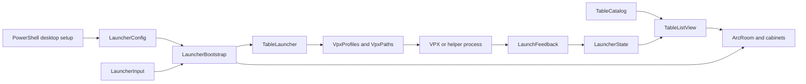

# Architecture

The launcher is a Windows x64 Unity/OpenXR application with a separate desktop
setup UI. VPX is an external process with its own XR session and configuration.

## Assemblies and extension points

| Location | Responsibility | Typical changes |
|---|---|---|
| `Assets/Scripts/Core` / `VRLauncher.Core` | Catalog, naming, view selection, state, launch commands, readiness, path rules, input latches | Sorting, metadata, parsing, selection and persistence |
| `Assets/Scripts/Arcade` / `VRLauncher.Arcade` | Cabinet meshes, room panels, media cache, input and fades | Visuals, navigation and control hints |
| `Assets/Scripts` / `VRLauncher.Runtime` | Configuration, bootstrap, XR lifecycle, Windows focus/process/registry APIs and external controller bridge | Launch recovery, Windows integration and orchestration |
| `Assets/Editor` | Build, preview and scene tools | Packaging and reproducible renders |
| `tools/SetupCore.psm1` | Health checks, INI repair, reviewed apply | Setup diagnostics and application |
| `tools/SetupPaths.ps1` | Setup's path/profile/ROM rules | Cross-language installation contract |
| `tools/SetupBackup.ps1` | Archive validation, export, reviewed restore and rollback | Persistence safety |
| `tools/setup.ps1`, `SetupBackupPage.ps1` | Windows Forms presentation | Desktop setup flows |

Core avoids scene/process orchestration. Its state and readiness JSON use
explicit data contracts so the same production files and tests run under Unity
and the portable .NET coverage target. Only `ArcLayout` still requires Unity
math and is measured in EditMode. `MenuInputState` owns input decisions while
`LauncherInput` samples hardware and dispatches the resulting actions.
EditMode tests reference Core, Arcade and Runtime. Copied-player runs and manual
hardware tests additionally check Windows/XR integration.

## Launch lifecycle

1. Bootstrap reads configuration, scans tables, loads player state and builds
   the room. `LauncherInput` emits actions; the view owns selection/filtering.
2. A launch disables navigation, fades the room and resolves the table's profile.
3. `TableLauncher` releases Unity's XR session and starts the selected program.
   Optional helpers forward arguments and own their VPX child.
4. The room pauses rendering while input/process monitoring continues. Fresh,
   matching VPX log lines can establish initialization or a script/ROM problem.
5. On exit, launch results are saved, eligible sessions increment play counts,
   XR restarts and the room returns to the selected table. A fallback session
   count can use a normal exit after 15 seconds; it is not gameplay certification.

`VpxProcessTree` limits emergency cleanup to the launched process tree. Normal
table exit is preferred; Backspace is an emergency rescue. `VpxBackgroundInput`
is optional and separate from the Meta/Oculus motion-controller bridge.

Process ancestry is checked against creation times to avoid granting ownership
to a reused process ID. Delayed focus attempts retain the original process
identity. `ITableLaunchPlatform` and `IXrSession` separate native effects from
the launch lifecycle so tests can use disposable processes and controlled XR
failures. Pending XR initialization is cancelled before the next handoff;
deferred failures notify the menu even after the normal table-exit event.

Bootstrap owns its generated room, fader and head-pose input actions. Disposal
unsubscribes lifecycle events and releases those resources without destroying
borrowed scene objects. The media cache owns loaded textures and shares pending
loads; one subscriber failure does not prevent other views receiving the result.

## Configuration and data ownership

- App-folder `launcher-config.json`: locations, profiles, controller launch
  options and media settings. Installed configuration is authoritative.
- Player `state.json`: relative table paths identify favorites, sessions,
  browsing state and launch outcomes. Renaming/moving tables changes those keys.
- VPX INIs, ROMs and table files: owned by VPX/table installations. Setup only
  repairs a reviewed, runtime-confirmed global VR setting when requested.
- Setup applies and restores preserve originals under app-folder `SetupBackups`.
  The per-user install keeps these paths writable. Program Files/all-users
  installs are not supported by this release's setup flow.

## Matching setup and runtime behavior

PowerShell must work without Unity installed; C# must run inside the player.
They therefore have separate implementations, checked against
`tests/fixtures/launch-contract.json` by PowerShell and Unity tests. Relative
paths and environment variables resolve against the launcher directory. Profile
matching ignores case; undefined assignments fall back to the default program.
INI paths and explicit working directories use the same base. `table` means the
selected table's directory.

ROM checks consider table-local `pinmame/roms`, absolute registry `rompath`
entries, and common libraries beside the actual VPX executable. Relative
registry entries and custom table INIs remain uncertain. Runtime helper targets
come from a known sidecar or explicit configuration; old helper source is only
setup evidence and still needs a launch test. Unknown helpers must not be
mistaken for a VPX installation.

Readiness never executes table scripts. A literal external `.vbs` ROM assignment
or optional `.readiness.json` supplies requirements; embedded/dynamic scripts
remain unknown. Installed plugin DLLs do not prove enablement or display routing.

## Useful boundaries to preserve

Preserve installed JSON rather than replacing it with samples. Deploy all three
managed assemblies with their matching player. Keep CI fixtures independent of
personal installations. Avoid adding another path/profile resolver: extend the
contract, then update the existing implementations together.
